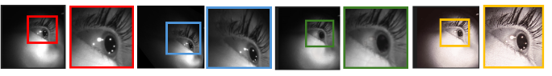
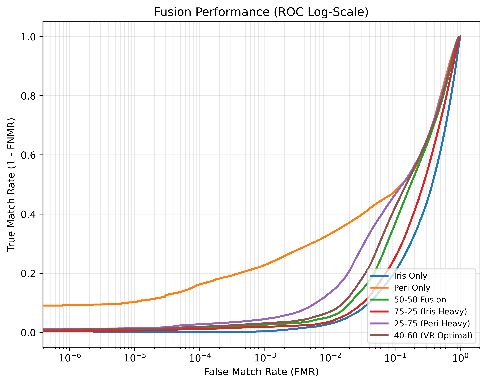

# Ocular Verification for Virtual Reality

Virtual reality (VR) headsets (e.g., Meta Quest, Apple Vision Pro) provide a seamless user experience due to their fast, frictionless interaction with the physical world in a simulated environment. User authentication relies on biometric cues such as iris in such headsets. However, traditional iris recognition protocols are not adequate in cases of unconstrained acquisition, which is typical of VR-based data. 

In this work, we examine three crucial aspects: 
1. Evaluating ISO/IEC 29794-6 iris quality metrics on the VRBiom dataset and analyzing their limitations.
2. Addressing data-specific challenges such as off-axis gaze, non-uniform illumination, and specular reflection using generative models.
3. Performing unimodal (iris, periocular) recognition and multimodal score-level fusion (iris + periocular). 

We observe that some metrics (e.g., margin adequacy) fail on VR-acquired data; whereas, image adjustments primarily benefit periocular recognition, and multimodal fusion lowers EER by ∼11% over unimodal iris recognition performance.

<p align="center">
  
  <br>
  <em><strong>Fig. 1.</strong> Examples of ocular image adjustment operations. 🟥: original frame; 🟦: output after off-axis correction via DINOv3+H8Net; 🟩: output after specular reflection removal via UnReflect; 🟨: output after uneven illumination correction via UNIR-Net. Zoomed-in views of the iris regions indicate effects after processing operations.</em>
</p>

## Video Frame Extraction

We used a custom OpenCV pipeline to parse raw `.avi` biometric videos into individual grayscale `.png` frames.

### Installation
```bash
pip install opencv-python numpy
```

### Run
```bash
python extract_all.py
```

## Specularity Removal (UnReflect)

We used the UnReflectAnything framework, an RGB-only single-image highlight removal pipeline.

### Installation
```bash
pip install unreflectanything==1.1.1
ura download --weights
```

### Run
```bash
python preprocessing/unreflect.py --in <input_frames_path> --out <output_frames_path>
```

## Non-Uniform Illumination Restoration (UNIR-Net)

We used the UNIR-Net framework, an illumination restoration network that combines illumination enhancement, attention mechanisms, visual refinement, and contrast correction to improve image quality and visibility.

### Installation
```bash
git clone [https://github.com/xingyumex/UNIR-Net.git](https://github.com/xingyumex/UNIR-Net.git)
cp preprocessing/unirnet.py UNIR-Net/   # pretrained weights are included in the cloned repo
```

### Run
```bash
cd UNIR-Net
python inference_unirnet.py --input <input_frames_path> --output <output_frames_path>
```

## Off-Axis Correction (OAC)

We used a foundation vision transformer (DINOv3) and a regression head (H8Net) to mitigate perspective distortion in unconstrained virtual reality imagery. The pipeline estimates an 8-DoF homography matrix to warp off-angle irises back into a frontal circular geometry.

### Installation
```bash
pip install torch torchvision torchaudio pillow
git clone [https://github.com/CVRL/OpenSourceIrisRecognition.git](https://github.com/CVRL/OpenSourceIrisRecognition.git)
```

### Run
```bash
python preprocessing/OAC.py
```

## Biometric Sorting & Dataset Intersection

We used the deep-learning-based ArcIris geometric regressor to evaluate and partition unconstrained ocular imagery into high-utility 'Valid Iris' and low-utility 'Periocular' datasets. The intersection script then synchronizes the processed valid dataset with unaltered raw counterparts to guarantee a fair 1:1 baseline evaluation.

### Installation
```bash
# Requires the CVRL OpenSourceIrisRecognition clone from the OAC step
pip install pandas
```

### Run
```bash
# Filter datasets based on geometric utility thresholds
python datasets/Biometric_Sorter.py

# Sync raw baseline dataset 1:1 with the filtered imagery
python datasets/Intersection.py
```

## Biometric Matching (Template Creation & Tensor Verification)

We used the ArcIris framework (ResNet100) to extract high-dimensional, discriminative .npz feature vectors from unwrapped polar irises. Pairwise matching is calculated entirely in GPU memory using PyTorch L2 normalization and cosine similarity, supporting both unimodal and multimodal score-level fusion.

### Installation
```bash
# Utilizes PyTorch and ArcIris dependencies already installed in previous steps
```

### Run
```bash
# Extract deep feature templates (Choose bulk extraction or targeted fusion extraction)
python matching/Templates_creation.py
python matching/templates_creation_fusion.py

# Run verification protocol (Choose unimodal baseline or multimodal score-level fusion)
python matching/Tensor_Unreflect.py
python matching/Tensor_fusion.py
```

## ISO Quality Evaluation (MITRE BIQT)

We used the MITRE BIQT and BIQTIris frameworks to automate the extraction of ISO/IEC 29794-6 biometric quality metrics across our datasets. A Python aggregation script then securely parses the telemetry into standard statistical distributions (mean ± std).

### Installation
Please install the official MITRE BIQT core framework and the BIQTIris plugin from their respective repositories. Ensure the `biqt` command is accessible in your system's PATH.
* https://github.com/mitre/biqt-iris/tree/master?tab=readme-ov-file
* https://github.com/mitre/biqt

### Run
```bash
# Extract ISO metrics to JSON format
bash evaluation/Get_json_files.sh

# Aggregate and compute global statistics
python evaluation/MITRE_nooac.py
```

## Performance Plotting (PyEER)

We used the PyEER framework to calculate the Equal Error Rate (EER) and Decidability Index ($d'$). Our customized scripts generate publication-ready FMR/FNMR, ROC, and DET curves with specifically formatted Matplotlib class overrides.

### Installation
Refer to pyeer repository for detailed information: https://github.com/manuelaguadomtz/pyeer
```bash
pip install pyeer matplotlib
```

### Run
```bash
# Generate unimodal baseline performance plots
python evaluation/pyeer_plot_new.py

# Generate multimodal score-level fusion performance plots
python evaluation/pyeer_plot_fusion.py
```
<p align="center">
  
  <br>
  <em>Fig. 2. ROC curves comparing various fusion variations </em>
</p>

## Citation

If you use this code or dataset in your research, please cite our paper:
https://arxiv.org/abs/2607.20790

## Acknowledgments

This material is based upon work supported by the National Science Foundation under Grant No. 2349771 through the HUMANS MOVE REU Site at the University of Wyoming.
We also acknowledge the Computer Vision Research Lab (CVRL) for their [OpenSourceIrisRecognition](https://github.com/CVRL/OpenSourceIrisRecognition) repository, from which the ArcIris and Off-Axis Correction (OAC) models were utilized. This framework serves as their official open-source submission to the NIST IREX X evaluation program.